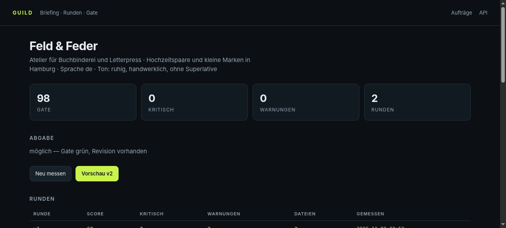

# Guild

Eine Design- und Entwicklungsfirma aus Rollen, Runden und einem Gate.

Ein Auftrag kommt als Briefing herein. Dann wird gebaut, kritisiert, revidiert — und am Ende
steht ein Gate, das die Abgabe aufhält, bis sie sauber ist. Nicht „sieht gut aus", sondern
nachprüfbar: Titel, Sprache, Beschreibung, Überschriftenordnung, Alt-Texte, interne Links,
Kontrast nach WCAG, Viewport, Gewicht.

```
Briefing → v1 bauen → messen → Kritik → v2 bauen → messen → Abgabe
```



## Warum

Eine Seite in einem Durchgang wirkt selten fertig. Was fehlt, ist nicht Talent, sondern der
zweite Blick und eine Schwelle, ab der man aufhört. Beides ist hier fest verdrahtet: keine
Abgabe ohne mindestens eine Revision, und keine grüne Abgabe mit einem kritischen Finding.

## Installation

```bash
./guild                    # läuft aus dem Checkout, rich genügt
pip install -e ".[ui]"     # als Kommando auf dem PATH, mit Browser-Oberfläche
```

## Befehle

```
guild                       Übersicht aller Aufträge
guild new <slug> …          Briefing anlegen
guild run <slug> [runde]    Runde durch das Gate schicken
guild show <slug>           Stand, Findings, Verlauf
guild compare <slug> v1 v2  zwei Runden vergleichen
guild ship <slug>           abgeben (nur bei grünem Gate)
guild build <slug>          Runden von Hermes-Agenten bauen lassen
guild plan <slug>           was welche Rolle liefert
guild web                   Studio im Browser (127.0.0.1:8800)
```

Exit-Codes: `0` ok · `1` Fehler · `2` Aufruf- oder Briefingfehler · `3` Gate rot.

## Ein Auftrag, von Anfang bis Abgabe

```
$ ./guild new feld-feder --kunde "Feld & Feder" --produkt "Atelier für Buchbinderei" \
    --zielgruppe "Hochzeitspaare und kleine Marken" \
    --ziel "Anfrage stellen" --seite index.html --seite kontakt.html
✓ Briefing angelegt: ~/clients/feld-feder/briefing.toml

$ ./guild run feld-feder v1
69/100 · 2 kritisch · 2 Warnungen
  critical  Kontrast   --muted auf --bg nur 2.78:1        style.css
  warn      Struktur   keine Meta-Beschreibung            index.html

$ ./guild run feld-feder v2
98/100 · 0 kritisch · 0 Warnungen

$ ./guild ship feld-feder
✓ abgegeben: ~/clients/feld-feder/abgabe
```

`guild compare feld-feder v1 v2` zeigt dann, welche Findings verschwunden und welche
dazugekommen sind, und welche Dateien sich geändert haben.

## Das Gate

Was gemessen wird, und warum es kritisch ist:

| Prüfung | Schwere | Grund |
|---|---|---|
| `<title>` vorhanden | kritisch | ohne Titel ist der Tab leer und der Verlauf wertlos |
| `<html lang>` | kritisch | Screenreader raten sonst die Aussprache |
| `alt` an jedem Bild | kritisch | ein Bild ohne Text existiert für einen Teil der Leser nicht |
| interne Links | kritisch | ein toter Link ist ein Fehler, kein Detail |
| Kontrast ≥ 4.5:1 (3:1 für Akzente) | kritisch | WCAG AA, nachgerechnet aus den Tokens |
| viewport | kritisch | ohne ihn rendert das Handy auf 980 px |
| genau ein `h1`, keine Sprünge | kritisch / Warnung | Hierarchie ist Navigation |
| Meta-Beschreibung | Warnung | Vorschauen und Suche raten sonst |
| ≤ 3 externe Abhängigkeiten | Warnung | jede ist ein Fremdausfall |
| Größenbudget (HTML 140 KB, CSS 45 KB) | Warnung | Gewicht ist eine Designentscheidung |
| jedes `` existiert und wiegt < 400 KB | kritisch / Warnung | ein fehlendes Bild ist ein leerer Kasten; 2 MB pro Foto bremsen die Seite |
| keine Platzhalter (`[ … ]`, TODO, Lorem, Musterstraße) | kritisch | ein Kundendatum, das fehlt, gehört ins Briefing — nicht als Klammer auf die Seite |
| Notiz zur Runde | Hinweis | warum so und nicht anders |

Der Score ist `100 − Summe der Gewichte` (kritisch 12, Warnung 3, Hinweis 1). Abgabe nur bei
0 kritischen Findings **und** mindestens zwei Runden — eine Zahl ohne Revision ist keine
Arbeit, sondern ein Entwurf.

## Echte Agenten

`guild build <slug>` baut die Runde nicht nach Rezept, sondern lässt einen Hermes-Agenten
arbeiten:

```bash
./guild build tischlerei-brandt --runden 2 --budget 420
  ⚑ bau  v1  272.6s  1605k Tokens · Gate 99/100 (0 kritisch)
  ⚑ bau  v2  339.8s  2039k Tokens · Gate 100/100 (0 kritisch)
✓ Gate grün — `guild ship tischlerei-brandt` gibt frei
```

Die erste Runde läuft in Rollen, nicht in einem Durchgang:

```
Strategie  →  Art Direction  ∥  Text  →  Bau
  32 s          69 s / 78 s parallel     204 s
```

Strategie schreibt `konzept.md` (Angebot, Zielgruppe, Abschnittsstruktur, Tonalität), dann
arbeiten Art Direction (`design/tokens.css` + `artdirection.md`) und Text (`inhalte.md`)
**gleichzeitig** — sie hängen nur von der Struktur ab, nicht voneinander. Erst danach baut
der vierte Agent aus diesen drei Ergebnissen. Revisionen laufen als ein Durchgang mit den
Findings der Vorrunde; Rollen werden nur beim ersten Aufbau eines Auftrags gestartet.

Der Agent läuft mit `hermes chat --oneshot --in <rundenordner> --max-turns 30`; sein
Arbeitsordner ist die Runde selbst. Er bekommt das Briefing, die Regeln des Gates und bei
Revisionen die Findings der Vorrunde im Klartext. Er schreibt die Dateien mit seinen
eigenen Werkzeugen — HTML, CSS, SVG, Notiz.

**Was es kostet.** Ein Lauf mit 30 Zügen liegt bei 1,6–2,0 Mio Eingabe-Tokens. Das ist
nicht die Länge der Seite, sondern der Verlauf: bei jedem Zug sieht das Modell die
bisherigen Schritte erneut, der größte Teil davon sind Cache-Wiederholungen. Zwei Runden
für einen Einseiter sind also ein paar Cent bis in den niedrigen Cent-Bereich, je nach
Modell und Anbieter. `guild show <slug>` und das Studio zeigen die Summe pro Auftrag.

**Was es nicht ist.** Kein Autopilot, der ohne dich Kunden anschreibt: `guild build` startet
nur auf deinen Aufruf, ein Lauf ist auf Züge und Zeit begrenzt, und ohne grünes Gate gibt es
keine Abgabe. Ein gekappter Lauf (⚑) ist kein Fehler — wenn dabei eine abgabefähige Runde
entstanden ist, wird sie gemessen und darf weiter.

**Der Unterschied zum Gate.** Der Agent gestaltet, das Gate urteilt. Beim ersten echten Lauf
lag v1 bei 99/100 und das einzige Finding war die fehlende Notiz — die Seite war gut, die
Buchführung fehlte. Genau dafür ist die Trennung da.

## Rollen

`guild plan <slug>` druckt die Checkliste:

| Rolle | Auftrag | Ergebnis |
|---|---|---|
| Strategie | Briefing lesen, Ziel schärfen, Seitenstruktur | `konzept.md` |
| Art Direction | Typografie, Farbsystem, Raster, Tokens | `design/tokens.css` |
| Text | Überschriften und Texte in der Stimme des Kunden | `inhalte.md` |
| Bau | HTML und CSS, semantisch, ohne Framework | `seite/` |
| Kritik | gegen Gate und Briefing lesen | `kritik.json` |
| Revision | Findings abarbeiten, jede Änderung begründen | `runde/` |
| Qualitätssicherung | messen | `qa.json` |

Die Rollen sind keine Sprachmodell-Aufrufe im Code — das Gate ist deterministisch, die
kreative Arbeit macht, wer sie macht: ein Agent oder ein Mensch. Guild hält den Prozess
zusammen, nicht die Ideen.

## Fakten gehören ins Briefing

Ein Briefing kann `fakten` tragen — Adresse, Öffnungszeiten, Telefon, Preise, Termine:

```toml
fakten = [
  "Adresse: Feldweg 3, 79112 Freiburg-Tiengen",
  "Selbstbedienung rund um die Uhr",
  "Theke: Freitag 15–18 Uhr",
]
```

Sie gehen verbindlich in jeden Prompt, und der Agent darf nichts davon erfinden. Fehlt eine
Angabe, wird sie weggelassen — nicht als `[bitte ergänzen]` stehen gelassen. Genau dieser
Fall ist beim ersten Durchlauf passiert: die Seite war mit 99/100 durch, obwohl 39
Platzhalter drinstanden. Seitdem ist das ein kritischer Fehler.

## Wo die Arbeit liegt

```
~/clients/<slug>/
  briefing.toml        was gebaut werden soll
  runden/v1/ …         jede Runde vollständig, nie überschrieben
  kritik/              Findings je Runde
  abgabe/              die freigegebene Fassung + ABGABE.md
~/.local/share/guild/guild.db    Messungen und Ereignisse
```

Kundendaten liegen außerhalb des Repos. Im Repo steht nur das Werkzeug.

## Grenzen

- Das Gate misst Struktur, Zugänglichkeit, Kontrast und Gewicht. Es misst **nicht**, ob die
  Gestaltung gut ist — dafür gibt es die Kritik-Rolle und den Menschen, der abnimmt.
- Kontrast wird aus den CSS-Tokens gerechnet, nicht aus gerendertem Text. Verläufe,
  Bilder als Hintergrund und `opacity` fallen durch dieses Netz.
- Nur statische Seiten. Wer ein Build-Werkzeug braucht, braucht ein anderes Werkzeug.
- Das Web-Fenster bindet auf Loopback, ohne Anmeldung. Es ist kein Dienst.

## Tests

```bash
python3 -m unittest discover -s tests -t .
```

20 Tests: Briefing-Roundtrip, jede Gate-Prüfung mit einer Runde, die sie auslösen muss,
Ablauf mit Revision und verweigerter Abgabe, jedes CLI-Unterkommando einmal echt.

## Lizenz

MIT.
